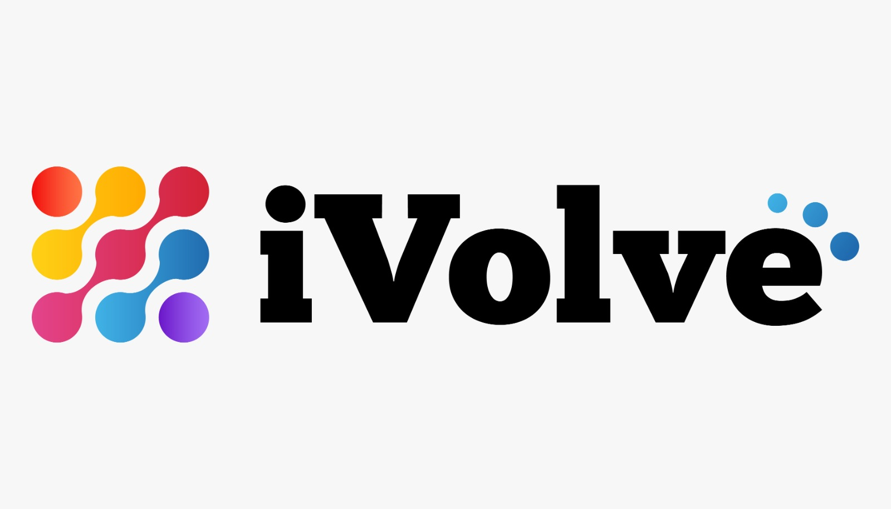

# iVolve Cloud DevOps Final Project

## Acknowledgment

**In Collaboration with iVolve Technologies**

This project represents the culmination of the DevOps training at the National
Telecommunication Institute (NTI), in partnership with iVolve Technologies.

<p>
  
  &nbsp;&nbsp;
  
</p>

End-to-end DevOps implementation for a microservices web application: local
containerization with Docker Compose, AWS infrastructure provisioning with
Terraform, configuration management with Ansible, container orchestration on
Amazon EKS with Kubernetes, CI pipelines with Jenkins (shared library), and
GitOps continuous deployment with ArgoCD.

The application source code is based on the public
[Ibrahim-Adel15/iVolveFinalProject](https://github.com/Ibrahim-Adel15/iVolveFinalProject)
repository.

---

## Table of Contents

1. [Architecture Overview](#1-architecture-overview)
2. [Repository Structure](#2-repository-structure)
3. [Application Services](#3-application-services)
4. [Docker - Local Build and Test](#4-docker---local-build-and-test)
5. [Terraform - AWS Infrastructure](#5-terraform---aws-infrastructure)
6. [Ansible - Jenkins Server Configuration](#6-ansible---jenkins-server-configuration)
7. [Kubernetes - Application Deployment](#7-kubernetes---application-deployment)
8. [Jenkins - CI Pipelines](#8-jenkins---ci-pipelines)
9. [ArgoCD - Continuous Deployment](#9-argocd---continuous-deployment)
10. [End-to-End Setup Guide](#10-end-to-end-setup-guide)
11. [Design Decisions and Notes](#11-design-decisions-and-notes)

---

## 1. Architecture Overview

### Application

```text
                        ┌──────────────┐
                        │   Browser    │
                        └──────┬───────┘
                               │ HTTP (Ingress / ALB)
                               ▼
                    ┌────────────────────┐
                    │  Frontend Service  │  Node.js / Express / EJS  (:3000)
                    └─────────┬──────────┘
                 ┌────────────┴────────────┐
                 ▼                         ▼
     ┌───────────────────┐     ┌──────────────────────┐
     │   Auth Service    │     │   Roadmap Service    │
     │ Python/Flask:5000 │     │ Java/Spring Boot:8080│
     └─────────┬─────────┘     └──────────────────────┘
               ▼
     ┌───────────────────┐
     │  MySQL (StatefulSet, headless Service, EBS volume)  │
     └───────────────────┘
```

### Platform / Tooling

```text
 GitHub (this repo)
      │  push
      ▼
 Jenkins EC2 (Terraform + Ansible: Java, Jenkins, Docker, Trivy, AWS CLI)
      │  per microservice: Build Image → Scan Image (Trivy) → Push Image (ECR)
      │                  → Delete Image Locally → Update Manifests → Push Manifests
      ▼
 Amazon ECR (3 repositories)
      ▲
      │ image tags committed back to Kubernetes/
 GitHub ──► ArgoCD Application ──► Amazon EKS (namespace: ivolve)
                                     frontend / auth-service / roadmap-service
                                     MySQL StatefulSet + ConfigMap + Secret + Ingress
```

All infrastructure lives in a dedicated VPC (public + private subnets across
two availability zones, Internet Gateway, NAT Gateway, Network ACL). The EKS
worker nodes (2, in different private subnets/AZs) run the application; the
Jenkins EC2 instance runs the CI pipelines.

---

## 2. Repository Structure

```text
CloudDevOpsProject/
├── App/                          # Application source code (microservices + Dockerfiles)
│   ├── frontend/                 # Node.js / Express / EJS  - port 3000
│   ├── auth-service/             # Python / Flask + MySQL   - port 5000
│   └── roadmap-service/          # Java / Spring Boot       - port 8080
│
├── Docker/
│   └── docker-compose.yml        # Builds and tests the app + MySQL database locally
│
├── Terraform/                    # AWS infrastructure as code
│   ├── backend.tf                # S3 remote state backend (+ DynamoDB locking)
│   ├── provider.tf / main.tf / variables.tf / outputs.tf
│   └── modules/
│       ├── network/              # VPC, public/private subnets, IGW, NAT, NACL
│       ├── server/               # Jenkins EC2 + Security Group (+ IAM profile)
│       ├── eks/                  # EKS cluster + 2 worker nodes in private subnets
│       └── ecr/                  # One ECR repository per microservice
│
├── Ansible/                      # Jenkins server configuration management
│   ├── ansible.cfg
│   ├── requirements.yml          # ansible-galaxy collections
│   ├── inventory/aws_ec2.yml     # Dynamic inventory (AWS EC2 plugin)
│   ├── playbooks/jenkins.yml
│   └── roles/
│       ├── java/                 # OpenJDK 17
│       ├── jenkins/              # Jenkins LTS (+ AWS CLI for the pipelines)
│       ├── docker/               # Docker Engine (+ compose plugin)
│       └── trivy/                # Trivy image scanner
│
├── Kubernetes/                   # All cluster manifests (namespace: ivolve)
│   ├── namespace.yaml
│   ├── configmap.yaml            # Non-sensitive environment variables
│   ├── secret.yaml               # EXAMPLE secrets - replace before deploying
│   ├── storageclass.yaml         # EBS gp3 StorageClass for the StatefulSet
│   ├── database/                 # MySQL StatefulSet + headless Service
│   ├── frontend/                 # Deployment + Service
│   ├── auth-service/             # Deployment + Service
│   ├── roadmap-service/          # Deployment + Service
│   ├── ingress.yaml              # ALB Ingress for the frontend
│   └── kustomization.yaml
│
├── Jenkins/
│   ├── Jenkinsfile-frontend
│   ├── Jenkinsfile-auth-service
│   └── Jenkinsfile-roadmap-service
│
├── vars/                         # Jenkins shared library (Build/Scan/Push/Delete/Update/Push steps)
│
├── ArgoCD/
│   └── application.yaml          # ArgoCD Application (GitOps sync into EKS)
│
└── README.md
```

---

## 3. Application Services

| Service         | Technology             | Port | Responsibility                        |
| --------------- | ---------------------- | ---- | ------------------------------------- |
| frontend        | Node.js / Express /EJS | 3000 | Web UI (signup, login, roadmap page)  |
| auth-service    | Python / Flask         | 5000 | Registration & login against MySQL    |
| roadmap-service | Java / Spring Boot     | 8080 | DevOps roadmap data API               |
| MySQL           | mysql:8.0              | 3306 | User accounts (database `ivolve`)     |

> **Note on the source repository:** the upstream README swaps the
> technologies of `auth-service` and `roadmap-service`. The actual source code
> is authoritative: `auth-service` is Python/Flask and `roadmap-service` is
> Java/Spring Boot. This project follows the actual code.

---

## 4. Docker - Local Build and Test

[`Docker/docker-compose.yml`](Docker/docker-compose.yml) builds all three
microservices from their Dockerfiles, starts a MySQL 8.0 database with a
persistent volume, wires the environment variables, and (with the `test`
profile) runs a test container that verifies the database, the frontend and
the roadmap API end to end.

```bash
cd Docker

# Run the application locally (UI on http://localhost:3000)
docker compose up --build

# Run the application together with the automated test container
docker compose --profile test up --build --abort-on-container-exit

# Tear down (add -v to also delete the database volume)
docker compose down
```

The test container checks:

1. `GET auth-service:5000/health` - auth service **and** its MySQL connection.
2. `GET frontend:3000/` - frontend renders the login page.
3. `GET roadmap-service:8080/api/roadmap` - roadmap API responds.

---

## 5. Terraform - AWS Infrastructure

[`Terraform/`](Terraform/) provisions the complete AWS environment using
modules, with the state stored in an S3 backend (with DynamoDB state locking).

| Module    | Resources                                                                                     |
| --------- | --------------------------------------------------------------------------------------------- |
| `network` | VPC, 2 public + 2 private subnets across 2 AZs, Internet Gateway, NAT Gateway + EIP, route tables, Network ACL |
| `server`  | Jenkins EC2 instance (Ubuntu 22.04) in a public subnet, Security Group (22, 8080), IAM role/profile for ECR and EKS |
| `eks`     | EKS cluster + managed node group with **2 worker nodes spread across the private subnets (different AZs)** |
| `ecr`     | 3 private repositories (`ivolve/frontend`, `ivolve/auth-service`, `ivolve/roadmap-service`), scan-on-push, lifecycle policy |

### Setup

```bash
# 1. Create the S3 backend resources once (bucket name must be globally
#    unique - update it in Terraform/backend.tf first):
aws s3api create-bucket --bucket ivolve-terraform-state-rahma --region us-east-1
aws s3api put-bucket-versioning --bucket ivolve-terraform-state-rahma \
    --versioning-configuration Status=Enabled
aws dynamodb create-table --table-name ivolve-terraform-locks \
    --attribute-definitions AttributeName=LockID,AttributeType=S \
    --key-schema AttributeName=LockID,KeyType=HASH \
    --billing-mode PAY_PER_REQUEST

# 2. Create an EC2 key pair named "ivolve-jenkins-key" (or change the
#    jenkins_key_name variable).

# 3. Provision:
cd Terraform
cp terraform.tfvars.example terraform.tfvars   # adjust values
terraform init
terraform plan
terraform apply

# 4. Configure kubectl for the new cluster:
aws eks update-kubeconfig --name ivolve-eks --region us-east-1
```

Key outputs: `jenkins_public_ip`, `jenkins_url`, `eks_cluster_name`,
`eks_cluster_endpoint`, `ecr_repository_urls`.

---

## 6. Ansible - Jenkins Server Configuration

[`Ansible/`](Ansible/) configures the Jenkins EC2 instance using **roles** and
a **dynamic inventory** (the `amazon.aws.aws_ec2` inventory plugin discovers
the running instance by its `Role=jenkins` tag - no hard-coded IPs).

| Role     | Installs                                                     |
| -------- | ------------------------------------------------------------ |
| `java`   | OpenJDK 17 (required by Jenkins)                             |
| `jenkins`| Jenkins LTS from the official repository, plus the AWS CLI v2 (needed by the pipelines to log in to ECR) |
| `docker` | Docker Engine + buildx/compose plugins; adds `jenkins` and `ubuntu` to the `docker` group |
| `trivy`  | Trivy vulnerability scanner                                  |

### Setup

```bash
cd Ansible

# Install the required collections (dynamic inventory plugin)
ansible-galaxy collection install -r requirements.yml

# The dynamic inventory plugin needs boto3/botocore on the control node
pip install boto3 botocore

# AWS credentials must be available for the dynamic inventory
export AWS_ACCESS_KEY_ID=... AWS_SECRET_ACCESS_KEY=...

# Verify that the Jenkins server is discovered
ansible-inventory --graph

# Run the playbook (use the key pair from the Terraform server module)
ansible-playbook playbooks/jenkins.yml --private-key ~/.ssh/ivolve-jenkins-key.pem
```

After the playbook finishes, browse to `http://<jenkins_public_ip>:8080` and
unlock Jenkins with the initial admin password:

```bash
ssh -i ~/.ssh/ivolve-jenkins-key.pem ubuntu@<jenkins_public_ip> \
    'sudo cat /var/lib/jenkins/secrets/initialAdminPassword'
```

---

## 7. Kubernetes - Application Deployment

[`Kubernetes/`](Kubernetes/) contains everything needed to deploy the
application into the **`ivolve`** namespace of the EKS cluster:

| Manifest                    | Purpose                                                        |
| --------------------------- | -------------------------------------------------------------- |
| `namespace.yaml`            | `ivolve` namespace                                             |
| `configmap.yaml`            | Non-sensitive env vars (DB host/port/name, service URLs)       |
| `secret.yaml`               | DB credentials + session secret - **EXAMPLE values, replace!** |
| `storageclass.yaml`         | `ebs-gp3` StorageClass (EBS CSI driver) for StatefulSet data   |
| `database/`                 | MySQL **StatefulSet** + **headless Service**                   |
| `frontend/`                 | Deployment (2 replicas) + ClusterIP Service                    |
| `auth-service/`             | Deployment (2 replicas) + ClusterIP Service                    |
| `roadmap-service/`          | Deployment (2 replicas) + ClusterIP Service                    |
| `ingress.yaml`              | AWS ALB **Ingress** exposing the frontend                      |
| `kustomization.yaml`        | Applies everything with one command                            |

> Kubernetes resource names must be lowercase, so the namespace is `ivolve`.

### Prerequisites on the EKS cluster

1. [AWS EBS CSI driver](https://docs.aws.amazon.com/eks/latest/userguide/ebs-csi.html) add-on (for the StorageClass).
2. [AWS Load Balancer Controller](https://docs.aws.amazon.com/eks/latest/userguide/aws-load-balancer-controller.html) (for the ALB Ingress).

### Manual deploy (without ArgoCD)

```bash
# 1. Replace the EXAMPLE values in Kubernetes/secret.yaml with real secrets.
# 2. Replace 000000000000 in the Deployment image fields with your AWS
#    account ID (or let the Jenkins pipeline do it automatically).
kubectl apply -k Kubernetes/
kubectl -n ivolve get pods
kubectl -n ivolve get ingress ivolve-ingress   # ALB DNS name of the app
```

---

## 8. Jenkins - CI Pipelines

[`Jenkins/`](Jenkins/) contains one `Jenkinsfile` per microservice. Every
pipeline runs the same six stages, implemented once in the **shared library**
(the [`vars/`](vars/) directory at the repository root):

1. **Build Image** - `docker build` from the service's Dockerfile (`vars/buildImage.groovy`)
2. **Scan Image** - Trivy scan; the build fails on CRITICAL vulnerabilities (`vars/scanImage.groovy`)
3. **Push Image** - ECR login, tag and push (`vars/pushImage.groovy`)
4. **Delete Image Locally** - cleans the image from the Jenkins agent (`vars/deleteImage.groovy`)
5. **Update Manifests** - writes the new image tag into the service's Deployment manifest (`vars/updateManifests.groovy`)
6. **Push Manifests** - commits and pushes the manifest back to GitHub, where ArgoCD picks it up (`vars/pushManifests.groovy`)

### Why the shared library lives in `vars/` at the repository root

Jenkins loads a Global Pipeline Library from the **root** of a Git repository
and expects the `vars/` directory there. Keeping `vars/` at the root of this
repository lets the whole project double as the shared library - no separate
repository is needed.

### Jenkins one-time setup

1. **Register the shared library**: *Manage Jenkins → System → Global Trusted
   Pipeline Libraries → Add*:
   - Name: `ivolve-shared-library`
   - Default version: `main`
   - Retrieval method: *Modern SCM → Git* → this repository's HTTPS URL
2. **Create credentials** (*Manage Jenkins → Credentials*):
   - `aws-credentials` - *Username with password*: AWS access key ID / secret access key
   - `github-credentials` - *Username with password*: GitHub username / personal access token (repo scope)
3. **Update placeholders**: set `ECR_REGISTRY` (your AWS account ID) and
   `REPO_OWNER` (your GitHub username) in each Jenkinsfile.
4. **Create three Pipeline jobs** (frontend, auth-service, roadmap-service),
   each using *Pipeline script from SCM* pointing at this repository with the
   matching script path (`Jenkins/Jenkinsfile-frontend`, etc.), and a GitHub
   webhook or poll trigger.

---

## 9. ArgoCD - Continuous Deployment

[`ArgoCD/application.yaml`](ArgoCD/application.yaml) defines an ArgoCD
`Application` that watches the `Kubernetes/` directory of this repository and
automatically syncs it into the `ivolve` namespace (automated sync with
`prune` and `selfHeal`).

```bash
# Install ArgoCD into the cluster (once):
kubectl create namespace argocd
kubectl apply -n argocd -f https://raw.githubusercontent.com/argoproj/argo-cd/stable/manifests/install.yaml

# Update the repoURL in ArgoCD/application.yaml with your GitHub username, then:
kubectl apply -f ArgoCD/application.yaml
kubectl -n argocd get applications
```

GitOps flow: Jenkins pushes a new image tag into `Kubernetes/<service>/deployment.yaml`
→ ArgoCD detects the change → rolls out the new version on EKS.

---

## 10. End-to-End Setup Guide

1. **Local verification** (optional): run the compose stack and its tests -
   see [section 4](#4-docker---local-build-and-test).
2. **Provision AWS** with Terraform (S3 backend first) - see
   [section 5](#5-terraform---aws-infrastructure).
3. **Configure the Jenkins server** with Ansible - see
   [section 6](#6-ansible---jenkins-server-configuration).
4. **Prepare Kubernetes**: install the EBS CSI driver and AWS Load Balancer
   Controller add-ons, update `secret.yaml` and the image account IDs - see
   [section 7](#7-kubernetes---application-deployment).
5. **Bootstrap the cluster state**: `kubectl apply -k Kubernetes/` (the first
   deploy pulls the `latest` placeholder images only after they are pushed;
   the first Jenkins build replaces them with real tags).
6. **Wire Jenkins**: register the shared library, add credentials, create the
   three pipeline jobs - see [section 8](#8-jenkins---ci-pipelines).
7. **Install ArgoCD** and apply the Application - see
   [section 9](#argocd---continuous-deployment).
8. Push a code change to a microservice → Jenkins builds, scans and pushes a
   new image to ECR → Jenkins updates the manifests → ArgoCD deploys it → the
   app is live at the ALB Ingress address.

---

## 11. Design Decisions and Notes

- **Single repository**: application, infrastructure, configuration
  management, manifests and pipelines live together; the Jenkins "Update/Push
  Manifests" stages edit this same repository, and ArgoCD syncs from it.
- **Shared library at `vars/` (repo root)**: required by Jenkins' Global
  Pipeline Library loading rules (see [section 8](#8-jenkins---ci-pipelines)).
- **No real secrets committed**: `Kubernetes/secret.yaml` contains obvious
  `example_*` values with a warning to replace them; `terraform.tfvars` is
  git-ignored (`terraform.tfvars.example` is the template); Jenkins reads all
  credentials from its own credential store.
- **Placeholders to replace before a real run**: the AWS account ID
  (`000000000000`) in the Deployment manifests and Jenkinsfiles,
  `YOUR_GITHUB_USERNAME` in the Jenkinsfiles and the ArgoCD Application, the
  S3 bucket name in `Terraform/backend.tf`, and the example secrets.
- **Source app reality vs. its README**: `auth-service` is Python/Flask and
  `roadmap-service` is Java/Spring Boot (the upstream README swaps them); this
  project follows the actual code.
- **Namespace casing**: Kubernetes names must be lowercase, hence `ivolve`.
- **MySQL in-cluster**: the database is a StatefulSet with a headless Service
  and an EBS-backed volume, per the assignment. In production you would
  typically use a managed database (RDS) instead.
- **Trivy gating**: pipelines fail on CRITICAL vulnerabilities; adjust
  `severity`/`exitCode` in the `scanImage` step if a different policy is
  wanted.
